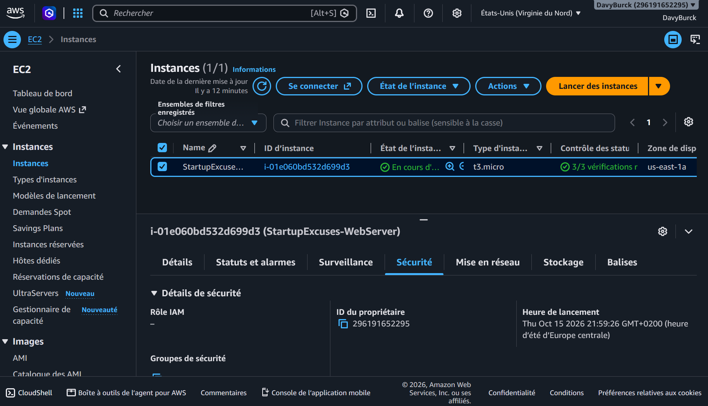
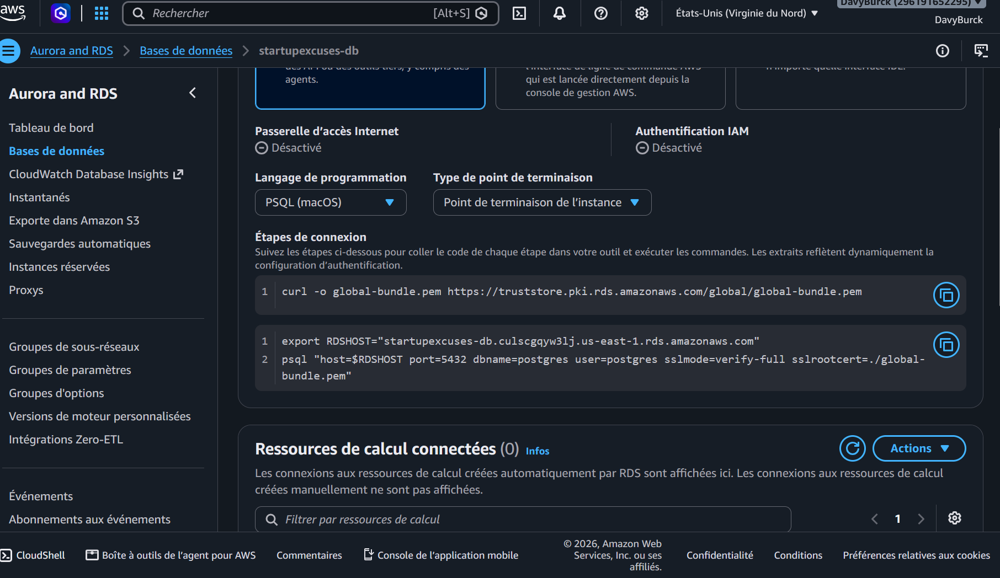
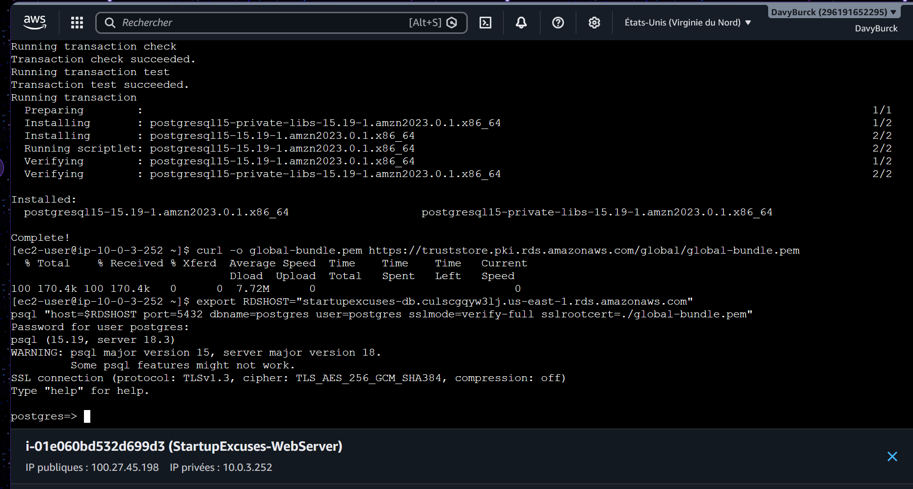

#  StartupExcuses — Architecture Cloud AWS Sécurisée (Modèle 2-Tier Optimisé)

##  Vue d'ensemble du projet
**StartupExcuses** est un projet d'infrastructure cloud conçu pour héberger une application web de manière hautement sécurisée, résiliente et optimisée financièrement. 

Réalisé dans le cadre de la préparation de ma formation en Cybersécurité, ce projet implémente une architecture réseau cloisonnée, garantissant une isolation stricte entre la surface d'exposition publique et les données sensibles.

---

##  Note de Conception : Pourquoi une architecture en 2 niveaux (2-Tier) ?
Bien que le cas d'usage initial du cours repose sur une **architecture académique à 3 niveaux** (séparant *Frontend*, *Application/Backend*, et *Database*), nous avons fait le choix délibéré d'adapter ce modèle vers une **architecture optimisée à 2 niveaux (Web + Database)** pour cette réalisation :

* **Justification économique & opérationnelle :** Dans le cadre d'un déploiement cloud réel soumis à des contraintes de budget ou à l'utilisation de l'offre gratuite AWS (*Free Tier*), l'implémentation d'un niveau d'application dédié (nécessitant des instances EC2 supplémentaires) aurait imposé l'ajout d'une passerelle **NAT Gateway** payante et d'un équilibreur de charge (**ALB**). 
* **Compromis technique et MVP :** En fusionnant la couche logique sur le serveur web public (`EC2`) et en isolant strictement la base de données (`RDS PostgreSQL`) dans un sous-réseau privé, nous conservons **100% des exigences de sécurité et de cloisonnement réseau** (principe de moindre privilège, pas d'exposition directe des données) tout en éliminant les coûts superflus. 

Ce choix démontre une capacité à adapter les concepts théoriques aux réalités financières et opérationnelles d'un projet d'entreprise ou d'une startup.

---

##  Architecture & Topologie Réseau (VPC)
L'infrastructure repose sur un **VPC dédié** (`StartupExcuses-vpc`) déployé dans la région `us-east-1` (N. Virginie)[cite: 4], segmenté en sous-réseaux pour séparer les flux :

* **CIDR du VPC :** `10.0.0.0/16`[cite: 4]
* **Sous-réseaux Publics (Web Tier) :** `10.0.1.0/24`, `10.0.2.0/24` (Hébergement du serveur Web EC2 avec accès Internet via une Internet Gateway)[cite: 4].
* **Sous-réseaux Privés (Database Tier) :** `10.0.3.0/24`, `10.0.4.0/24` (Hébergement de la base de données RDS isolée, sans accès direct depuis Internet)[cite: 4].

---

##  Sécurité et Cloisonnement (Security Groups)
Le principe de moindre privilège a été appliqué rigoureusement via l'utilisation de deux groupes de sécurité distincts :

1. **`WebServerSecurityGroup`**[cite: 4] :
   * Autorise le trafic **HTTP (Port 80)** et **HTTPS (Port 443)** depuis Internet (`0.0.0.0/0`).
   * Autorise le trafic **SSH (Port 22)** restreint.
2. **`DatabaseSecurityGroup`**[cite: 4] :
   * Autorise le trafic **PostgreSQL (Port 5432)** **uniquement** en provenance du `WebServerSecurityGroup` (refus total de toute autre source).

---

##  Stack Technique & Services AWS
* **Cloud Provider :** Amazon Web Services (AWS - Region `us-east-1`)[cite: 4].
* **Réseau :** Amazon VPC, Subnets (Public/Private), Route Tables, Internet Gateway.
* **Calcul (Frontend) :** Amazon EC2 (Instance `t3.micro`, OS : *Amazon Linux 2023*), client PostgreSQL 15[cite: 36].
* **Données (Backend) :** Amazon RDS (PostgreSQL 18.3-R2, configuration Mono-AZ, Offre Gratuite Free-Tier).
* **Sécurité :** Chiffrement des flux en transit via TLS v1.3 (certificat global RDS)[cite: 39].

---

## 📸 Captures d'écran & Validation de l'Infrastructure

### 1. Lancement du serveur Web EC2 (Sous-réseau public)

### 2. Configuration et point de terminaison RDS

### 3. Test de connectivité chiffrée vers la base de données

---

##  Guide de Déploiement (Étapes Clés)
1. **Création du VPC** personnalisé et de ses sous-réseaux[cite: 4].
2. **Configuration des pare-feux** (`WebServerSecurityGroup` et `DatabaseSecurityGroup`)[cite: 4].
3. **Déploiement de la base de données RDS** PostgreSQL dans le sous-réseau privé[cite: 4].
4. **Lancement de l'instance EC2** dans le sous-réseau public[cite: 4].
5. **Validation technique** : Installation de `postgresql15`[cite: 36] et test de connexion chiffrée `psql` (TLS v1.3)[cite: 39].

---
*Projet réalisé dans le cadre de la préparation de mon portfolio pour ma formation en cybersécurité / technologies du cloud.*
